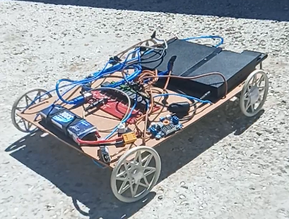
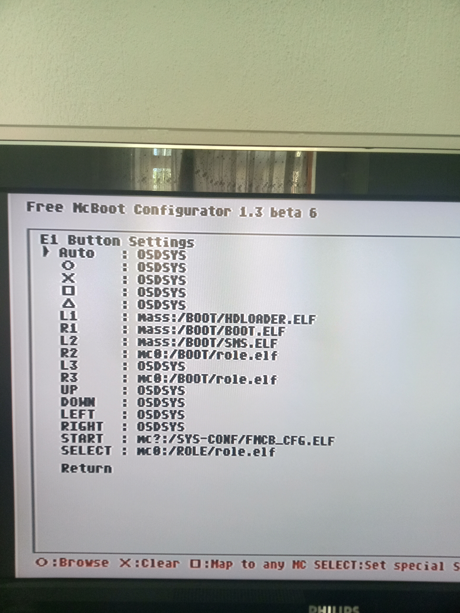

# PS2 Robot Vehicle — DualShock-driven relay car on a PlayStation 2


A homebrew PlayStation 2 application that turns a PS2 Slim into the brain of a
four-motor robot vehicle. The console drives a **Seda Elektronik 8-channel USB HID
relay board** over its USB port; the relays switch four RS-540 DC motors and the
DualShock controller steers the vehicle tank-style. The whole thing runs from a
battery, no PC and no extra microcontroller involved.

| | |
|---|---|
|  |  |

## Features

- **Direct USB HID control from the PS2** — a custom IOP driver (`iop/seda_relay_irx.c`)
  talks to the relay board through Sony's `usbd.irx`; the EE side (`main.c`) calls it over SIF RPC.
- **Tank-style driving** with Cross / Triangle / Square / Circle (forward, reverse, turn left, turn right).
- **Software interlock and relay dead time** — opposite relays of one motor group are never
  energised together; a configurable dead time (default 100 ms) protects the contacts on direction changes.
- **Safe shutdown** on controller disconnect, emergency stop (SELECT) and program transitions —
  every relay is switched off individually with verified commands.
- **Motion programming mode** — record up to 128 one-second steps with the controller, replay them
  with START, store them on the memory card (`ROLEPRG.TXT`) and replay with a single button (L2).
- **On-console settings screen** — VID/PID, USB send mode (12 diagnostic modes for undocumented
  HID boards) and dead time are editable on the TV and saved to `mc0:SYS-CONF/ROLECFG.TXT`.
- **Single self-contained ELF** — `usbd.irx` and the relay driver are embedded with `bin2c`;
  boots from a memory card (FreeMCBoot / uLaunchELF) or a burned disc.

## Repository layout

```
main.c                  EE application: controller, screen, menus, memory card, RPC calls
seda_relay_rpc.h        Shared EE/IOP protocol definitions
iop/                    IOP USB driver + RPC server (seda_relay_irx.c, imports.lst, Makefile)
Makefile                EE build (embeds usbd.irx and the IOP driver)
build.ps1               Sets up PS2SDK environment, builds, strips -> role.elf
build-disc.ps1          build.ps1 + bootable ISO (role-disc.iso) via xorriso
run-pcsx2.ps1           Launches the ELF in PCSX2 (menus/controller only; USB is not emulated)
role.elf                Prebuilt, stripped executable (copy to memory card or USB stick)
disc/                   SYSTEM.CNF + ROLE.ELF for a bootable disc
role-disc.iso           Prebuilt bootable disc image
windows-test/           C# WinForms tester for the same relay board on Windows (protocol reference)
docs/en/                English documentation (see below)
docs/tr/                Turkish originals
images/                 Vehicle and motor photos, generated artwork
```

## Documentation

English (`docs/en/`):

| Document | What it covers |
|---|---|
| [PROJECT_GUIDE.html](docs/en/PROJECT_GUIDE.html) | Software architecture: EE/IOP split, USB HID transfer in three steps, SIF RPC, the relay protocol, motion programming mode, glossary |
| [PHASE1_ELECTRONICS.html](docs/en/PHASE1_ELECTRONICS.html) | Safe electronics: power architecture, fusing, cable sizing, buck regulator setup, battery choice, relay/motor wiring, assembly and test protocol |
| [PROJECT_PHASES.html](docs/en/PROJECT_PHASES.html) | Roadmap: drive → wireless control → EyeToy camera research → single frame → MJPEG stream |
| [PS2_Slim_Battery_Power_Report.html](docs/en/PS2_Slim_Battery_Power_Report.html) | Battery and power plan with run-time estimates, parts list and budget baskets |
| [Lessons learned](docs/en/LESSONS_LEARNED.md) | Field failures and fixes: power wiring, resets, HID protocol, interlocks, ELF stripping, automatic boot, and diagnostics |
| [English slide show](docs/presentation/PS2_Robot_Vehicle_Complete_Story_EN.ppsx) · [10-second GIF](docs/presentation/PS2_Robot_Vehicle_Complete_Story_EN.gif) | Complete English project story with wiring diagram, commands, solved problems, build-size explanation, and road testing |
| [Turkish slide show](docs/presentation/PS2_Robot_Vehicle_Complete_Story_TR.ppsx) · [10-second GIF](docs/presentation/PS2_Robot_Vehicle_Complete_Story_TR.gif) | Turkish edition of the complete project story |

Turkish originals are in `docs/tr/` (`PROJE_REHBERI.html`, `FAZ1_ELEKTRONIK.html`,
`PROJE_FAZLARI.html`, `PS2_Slim_Batarya_Guc_Raporu.html`).

## Hardware

- PlayStation 2 Slim with FreeMCBoot (or any way to run homebrew ELFs)
- Seda Elektronik 8-channel USB HID relay board (`VID 0x178E / PID 0x07D9`; two USB cables:
  5 V power and HID data, both on the PS2's USB ports)
- 4 × RS-540 DC motors, wired as two parallel pairs (left / right)
- 3S LiPo (current build) or 12.8 V LiFePO4 (recommended), buck regulator set to **8.50 V** for the PS2
- Fuses, main switch, silicone stranded cable — see `docs/en/PHASE1_ELECTRONICS.html`

Relay wiring (per motor group): all NC contacts on battery (−), all NO contacts on battery (+),
COM1/COM2 to the left motor pair, COM3/COM4 to the right motor pair. One relay on → motor runs;
both off or both on → motor stopped.

## Controls

| Button | Action |
|---|---|
| Cross | Forward (relays 1 + 3) |
| Triangle | Reverse (relays 2 + 4) |
| Square | Turn left (relays 2 + 3) |
| Circle | Turn right (relays 1 + 4) |
| START | Enter programming mode / run the recorded program |
| SELECT | Cancel recording / emergency stop |
| R1 | Settings screen (normal mode) · add 1 s wait step (programming mode) |
| L1 / L2 | Save program to memory card / load it (programming mode) |
| L2 | Load and immediately run the saved program (normal mode) |
| START + SELECT | Return to the PS2 main menu |

## Building

Requirements (Windows): [PS2SDK](https://github.com/ps2dev/ps2sdk) installed under `C:\ps2dev`,
MSYS2 (`make`, `xorriso`), PowerShell.

```bash
powershell -ExecutionPolicy Bypass -File build.ps1
```

produces `role.elf` (debug symbols stripped). To also build the bootable ISO:

```bash
powershell -ExecutionPolicy Bypass -File build-disc.ps1
```

The paths at the top of `build.ps1` / `build-disc.ps1` assume the SDK in `C:\ps2dev`; adjust them
if yours lives elsewhere. Generated intermediates (`*.o`, `relay.elf`, the `bin2c` outputs
`usbd_irx.c` / `seda_relay_irx.c` in the root, `iop/obj`, `iop/*.irx`) are ignored by git.

## Running

1. Copy `role.elf` to a memory card or USB stick and launch it from uLaunchELF, **or** burn
   `role-disc.iso` and boot it from FreeMCBoot.
2. Plug the relay board's two USB cables into the PS2 Slim.
3. Drive. The on-screen `result` / `status` / `ctrl` / `int` values are the USB diagnostics —
   they are the only way to debug on a real console.

PCSX2 (`run-pcsx2.ps1`) is useful for the controller, menu and memory-card logic, but USB
pass-through is not reliable in the emulator; the relay protocol can only be verified on real hardware.

## Windows tester

`windows-test/` contains a small C# WinForms program (`SedaRelayTester`) that drives the same board
from Windows through `usbGenericHidCommunications.dll`. It was the only protocol reference available
and is kept for comparison. Build with:

```bash
powershell -ExecutionPolicy Bypass -File windows-test/build.ps1
```

## Status and roadmap

Phase 1 (battery-powered, controller-driven vehicle) is complete and test-driven.
Next steps, in order, are described in `docs/en/PROJECT_PHASES.html`: wireless control over the
PS2's Ethernet port with a WiFi bridge, EyeToy camera research, single-frame capture, MJPEG streaming,
and eventually replacing the relay board with a custom HID microcontroller board (PIC18F4550 /
PIC16F1455) that implements the same 8-byte packet format.

## Road-test videos

- [PS2 robot vehicle — short video 1](https://www.youtube.com/shorts/x-vaeMoXdgk)
- [PS2 robot vehicle — short video 2](https://www.youtube.com/shorts/5uW2evH4y8U)

The Turkish problem log is available at [`docs/tr/COZULEN_SORUNLAR.md`](docs/tr/COZULEN_SORUNLAR.md).

## Acknowledgements

Built on [PS2SDK](https://github.com/ps2dev/ps2sdk) and Sony's `usbd.irx`. Developed with the help of
Claude (Anthropic) and ChatGPT (OpenAI) as pair-programming assistants.
