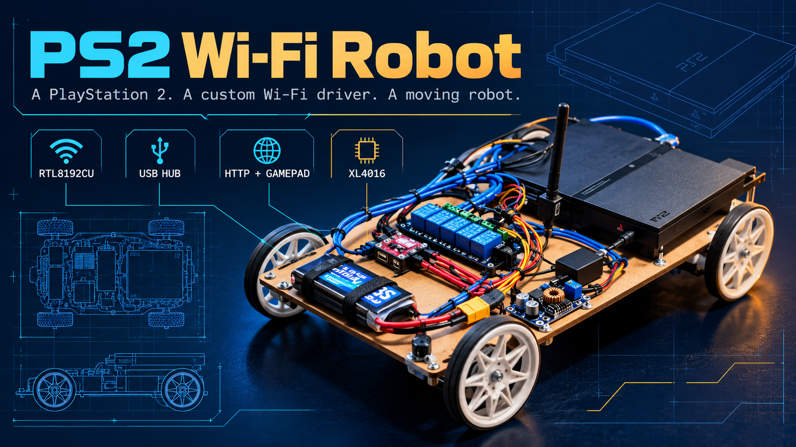
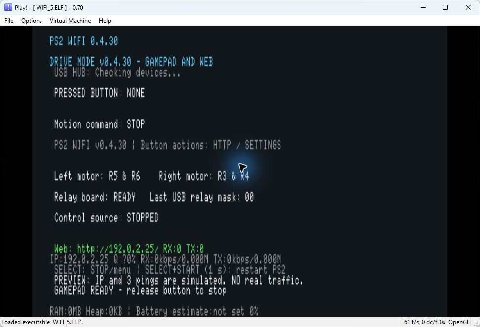
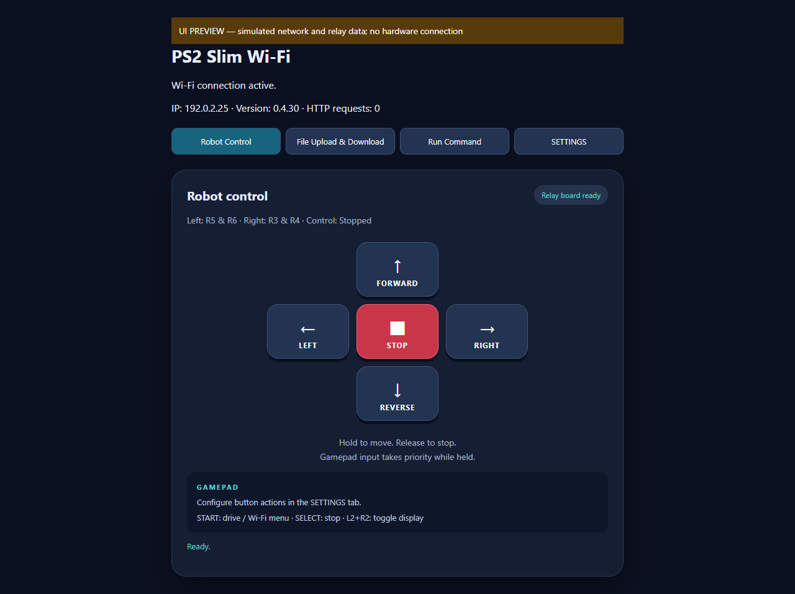

# PS2 Wi-Fi Robot



A real **PlayStation 2 Slim** controls a four-motor robot over **USB Wi-Fi**, serves its own browser interface and accepts a DualShock gamepad. A custom RTL8192CU driver takes the console from USB attachment to real WPA2 networking, DHCP, ping and HTTP. No PC is required during normal driving.

**[Download Wifi.elf 0.4.30](wifi/Release/Wifi.elf)** · [Quick start](wifi/RELEASE_README_EN.txt) · [Architecture](docs/en/WIFI_ARCHITECTURE.md) · [HTTP API](docs/en/WIFI_API.md) · [Validation](docs/en/WIFI_VALIDATION.md) · [Screenshots](docs/screenshots/wifi/README.md)

The integrated application lives in **[`wifi/`](wifi/)**. Root-level `role.elf` and its source preserve the earlier wired robot project. Its older controls, wiring and screenshots are not the current Wi-Fi release.

## Features

| Feature | What runs on the PS2 |
|---|---|
| Physical USB Wi-Fi | RTL8192CU discovery, firmware loading, radio setup, SSID scan, 802.11 authentication/association, WPA2, DHCP, ARP and ICMP |
| Browser driving | English **Robot Control**, **File Upload & Download**, **Run Command** and **Settings** tabs |
| Gamepad priority | Independent control thread, release-to-stop, emergency stop, relay interlocks and configurable dead time |
| Programmable buttons | Multiple ordered actions per button: stop, wait 100 ms, individual relay on/off; JSON persistence |
| USB hub support | Correct port routing, startup discovery, reset recovery and complete hub status bitmaps |
| Offline recovery | Every 30 seconds, cached USB descriptors are checked for Wi-Fi and known-network recovery is requested; connected sessions and active WPA/DHCP exchanges are preserved |
| File manager | Trees, upload/update, download and text/hex/media views across `mc0:`, `mc1:` and `mass:` |
| On-console compilation | C++ **statement subset** and MIPS assembler generate and execute native EE code **on the console**, with browser output |
| Diagnostics | USB IDs/descriptors/endpoints, hub ports, packet counters, transfer speed, available signal data and timestamped logs |
| Headless operation | Boots into drive mode with TV drawing off; L2+R2 or web Settings toggles the display |

## The driver work

### RTL8192CU Wi-Fi

This is a purpose-built PS2 USB Wi-Fi driver and network integration, **not a PC Ethernet client pretending to be Wi-Fi**. The IOP handles the physical adapter and radio; the EE handles the connection workflow and network services.

The project uses separately licensed **Realtek firmware**, **Mbed TLS cryptography** and attributed **NetBSD/FreeBSD radio/TKIP references**. “Custom driver” does not imply that the radio firmware or every underlying algorithm was invented here. [Source map and credits](docs/en/WIFI_ARCHITECTURE.md)

### USB host and hub

We extended the open-source **PS2SDK USBD hub driver**. A one-based lookup error applied a port's status to the next child; the corrected driver matches each child's real attached port number. It also scans pre-connected devices, includes port eight in the interrupt bitmap and releases a stuck global reset lock after a bounded timeout.

The relay is **not tied to one hub socket or USB device ID**. Tests cover eight port numbers with eight reordered child lists. The owner has also confirmed that the relay board works through the four-port hub on the physical PS2. This validates that setup, not every hub or electrical power arrangement. [Local driver changes](wifi/third_party/ps2sdk-usbd/LOCAL_CHANGES.md)

## Hardware used

| Component | Current vehicle |
|---|---|
| Console | PS2 Slim with homebrew ELF boot support |
| Wi-Fi | RTL8192CU, tested **0BDA:8178** |
| Relays | Seda Elektronik eight-channel USB HID, **178E:07D9** |
| Hub | Four-port USB 2.0 hub, tested **0A05:7211** |
| Motors | Four RS-540 DC motors, two per side |
| Battery | 3S 3300 mAh LiPo |
| Regulator | **XL4016**, current PS2 supply output **8.6 V** |

The relay board has separate data and power cables. A power-only cable does not enumerate as a USB device. Software cannot measure USB supply capacity or fix insufficient power. Battery percentage is a configurable consumption **estimate**, not a sensor measurement.

Motor groups can use R1/R2, R3/R4, R5/R6 or R7/R8; left/right conflicts are prevented. The tested vehicle uses R5/R6 on the left and R3/R4 on the right. **Never energize every motor relay together.** The optional startup pulse uses only unassigned R1 for 100 ms and is skipped if that group drives motors.

## Install

1. Download [`wifi/Release/Wifi.elf`](wifi/Release/Wifi.elf), or build it below.
2. On an existing installation replace **only** `mc0:/Wifi/WIFI.ELF`. Preserve `SEED.DAT`, saved profiles, `bilinenaglar.csv` and `ayarlar.json`. Keep backups on the PC, not the memory card.
3. For first-time setup follow [the release instructions](wifi/RELEASE_README_EN.txt). The build generates a private random `Wifi.seed` only if none exists; seeds and passwords are deliberately absent from GitHub.
4. Create UTF-8 `bilinenaglar.csv` beside the ELF using `SSID;Password` rows. [Example](wifi/bilinenaglar.example.csv). Manual password entry is also available.
5. Launch the ELF. It starts in **drive mode with the TV display off**. L2+R2 reveals status and the assigned IP.
6. Open `http://<PS2-IP>/` on the same LAN, or ping that address.

| Input | Current application |
|---|---|
| Cross / Triangle / Square / Circle | Default forward / reverse / left / right; configurable actions |
| Release movement button | Stop |
| SELECT | Emergency stop / leave drive screen; Wi-Fi and HTTP remain active |
| START | Switch drive/network screens |
| L2 + R2 | Toggle TV drawing |
| R2 while offline in drive mode | Retry a known network |
| R2 in network list | Connect with saved password; known SSIDs have `*` |
| Triangle in network list | Edit IP settings |
| SELECT + START for one second | Request PS2 system restart |

## Build and test

The Windows setup uses PS2DEV/PS2SDK in `C:\ps2dev`, MSYS2 in `C:\msys64`, PowerShell and Node.js 18+. Adjust script paths for other layouts.

```powershell
cd wifi
powershell -ExecutionPolicy Bypass -File build.ps1
node tests/physical_protocol.cjs
```

The stable output is **`wifi/Release/Wifi.elf`**. Test ELFs and intermediates stay outside Release. `web/` contains the English UI; `tools/build-web-assets.cjs` validates scripts and rebuilds the embedded headers. Modules and firmware are embedded into the production ELF.

Additional host tests (MSYS2 GCC):

```powershell
gcc -std=c99 -Wall -Wextra -Werror -Itests tests/usbd_reset_watchdog.c -o reports/usbd-test.exe
reports/usbd-test.exe
gcc -std=c99 -Wall -Wextra -Werror -Iinclude tests/usb_inventory.c -o reports/inventory-test.exe
reports/inventory-test.exe
```

[Validation details](docs/en/WIFI_VALIDATION.md) distinguish host tests, native EE/IOP emulator tests and physical hardware observations.

## Screens and artwork

| Console renderer in Play! | Browser interface preview |
|---|---|
|  |  |

[English screenshot gallery](docs/screenshots/wifi/README.md) · [New poster](images/ps2-robot-poster.png) · [Real vehicle photo](images/vehicle.png)

Screenshots explicitly identify emulator or UI-fixture data. The banner and poster are AI-generated promotional illustrations based on the vehicle, not wiring diagrams or hardware screenshots.

## Current limits

- Implemented security: WPA2-Personal with CCMP pairwise encryption and supported CCMP/TKIP group handling. No WPA3/SAE, enterprise authentication or mandatory PMF.
- The PS2 USB host is full-speed. The current transmit path uses CCK 1 Mbps; PC adapter benchmarks do not describe PS2 throughput. Protocol and memory-card overhead reduce file speeds further.
- The on-console language is a documented statement subset, **not full C++**: no classes, templates, STL or includes. Native code has no memory isolation; a timeout is not a security sandbox.
- HTTP file and code tools are for a **trusted LAN**, without TLS or full authentication. Do not expose them to the Internet.
- CPU utilization and temperature remain unavailable without implemented measurements. Application heap allocation is not whole-system RAM utilization.
- A tested hub/relay setup does not prove every hub, socket permutation or repeated power cycle. See the validation record for the actual evidence.

## Earlier project

Root `main.c`, `role.elf`, disc builds, Windows relay tester and bilingual documents preserve the wired version. [Legacy overview](docs/en/LEGACY_README.md) · [Earlier lessons](docs/en/LESSONS_LEARNED.md)

Current application code uses the [MIT license](wifi/LICENSE). Third-party components retain their own licenses. This independent homebrew project is not an official Sony product.
