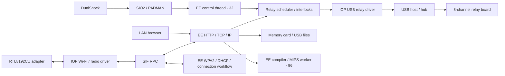

# Architecture and implementation

Lower EE priority values run first: control 32, video 48, pad initialization/recovery service 56, network/main 64, native worker 96. File transfers temporarily raise networking to 40; gamepad control remains above it. Pad binding/open/close RPCs run in a separate service. Disabling TV drawing skips the renderer; power savings have not been measured.

## Source map under `wifi/`

| Source | Responsibility |
|---|---|
| `ee/wifi.c` | Startup, workers, asynchronous RPC, offline recovery and integration |
| `ee/wifi_physical.h` | Scan, association, WPA2 workflow, address conflict handling and online services |
| `iop/rtl_probe.c`, `src/rtl_radio.c`, `src/rtl_wire.c` | Physical USB transfers, firmware/radio setup and framing |
| `src/rtl_supplicant.c`, `rtl_wpa_crypto.c`, `rtl_tkip*.c` | Keys, validation and protected data |
| `src/rtl_dhcp.c`, `rtl_acd.c`, `rtl_echo.c`, `rtl_http.c` | DHCP lease lifecycle, ARP, ping and bounded TCP/HTTP |
| `iop/relay/seda_relay_irx.c`, `ee/robot_usb.h` | HID relay protocol and acknowledged scheduling |
| `src/robot_program.c` | JSON action sequences, waits and opposite-relay validation |
| `third_party/ps2sdk-usbd/` | Pinned USB host/hub source and project fixes |
| `iop/usb_inventory_impl.h`, `ee/device_inventory.h` | Cached USB presence, metadata and port inventory |
| `ee/wifi_render.c`, `src/wifi_app.c`, `web/` | English TV, keyboard, state and browser UI |
| `ee/background_job.h`, `src/ps2_compile.c` | PS2-local compilation, execution, output and timeout |

## USB details

The upstream child lookup advanced once for port 1, selecting the next child. The fix matches `m_attachedToPortNo`, including reordered child lists. Pre-connected ports are scanned before relying on change interrupts. Bitmap length includes the hub's own bit and the last port.

A watchdog bounds failed/busy/missing reset completion, releases the global reset token and retries that child. Successful reset and unplug cancel the watchdog. Timer cancellation preserves subsequent deadlines. Exported ABI and power checks are preserved. [Exact changes](../../wifi/third_party/ps2sdk-usbd/LOCAL_CHANGES.md)

The 30-second offline scan reads cached enumeration descriptors without long control transfers. It matches VID/PID across USB IDs. Connected links, password entry and current WPA/DHCP exchanges are not restarted by the timer.

## Persistence and native jobs

Existing settings/profile/CSV filenames are retained for compatibility. Updates stage `.part`, validate on the console and replace the target. Deployment archives on the PC and checks the final remote byte count without re-downloading the installed ELF.

Source is compiled in an EE worker into MIPS in a 256 KiB arena, with at most 64 KiB code, 3072 source bytes and a two-second worker limit. The statement subset supports int/bool locals, arithmetic, comparisons, short circuit operators, if/else, while, return, output, time and yield functions. Assembly supports implemented integer/load/store/branch instructions, labels, `.word`, `text`, `print` and `ret`. Unsupported language features produce errors. Arbitrary native memory access remains possible; this is not a sandbox.

## Credits and licenses

- Application/integration: [MIT](../../wifi/LICENSE).
- USB host/hub: [PS2SDK](https://github.com/ps2dev/ps2sdk), Academic Free License 2.0; [pinned source](../../wifi/third_party/ps2sdk-usbd/UPSTREAM.json).
- Unmodified Realtek firmware: [license](../../wifi/third_party/realtek-firmware/Realtek-Firmware-License.txt).
- Attributed NetBSD `urtwn` / FreeBSD TKIP references: [sources and notices](../../wifi/third_party/urtwn-reference/).
- Cryptographic primitives: [Mbed TLS / Apache 2.0](../../wifi/third_party/mbedtls/LICENSE).
- Emulator integration/screens: [Play!](https://github.com/jpd002/Play-); emulator evidence is separated from physical tests.
